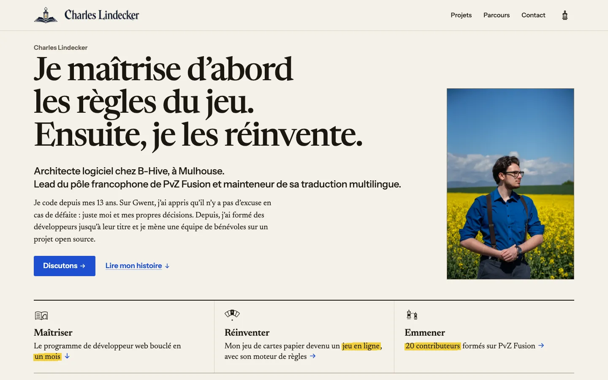
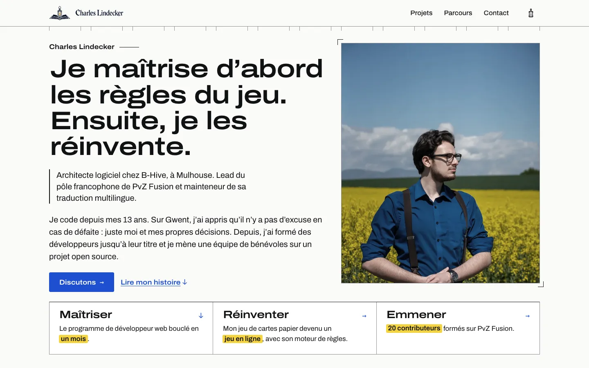
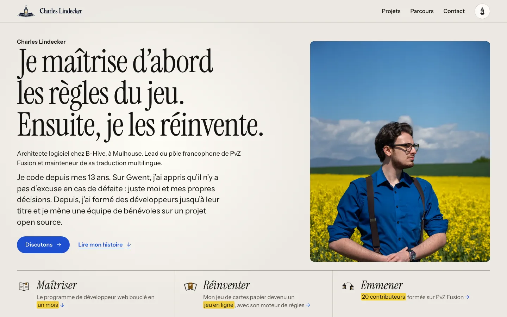

# Refonte du portfolio : trois directions visuelles

Maquettes corrigées du 13 octobre 2026, sur le contenu réel : accueil, vitrine des projets, page
PvZ Fusion et page Compétences, de jour et de nuit, sur ordinateur (1 440 × 900) et sur téléphone
(390 × 844). La comparaison complète, avec les premiers écrans et des extraits de chaque page, est
dans [index.html](index.html) : l’ouvrir dans un navigateur, sans serveur ni JavaScript.

Les trois accueils racontent la même histoire avec la même structure, et tous montrent désormais la
photo en couleur et la preuve « Emmener » chiffrée. Le choix porte sur la voix typographique, la
façon de montrer les preuves, la nuit et la signature. Questions pour trancher (cahier, § 8.5) :
un recruteur comprend-il le profil en dix secondes ? la page PvZ se lit-elle en diagonale ? la
nuit ressemble-t-elle à Charles sans évoquer Nocturne ? les captures sont-elles lisibles à 390 px ?
Charles s’y reconnaît-il ?

## A — Édition reliée

[Accueil](a-edition-reliee/accueil.html) · [Projets](a-edition-reliee/projets.html) ·
[PvZ Fusion](a-edition-reliee/pvz-fusion.html) · [Compétences](a-edition-reliee/competences.html) ·
[notes de conception](a-edition-reliee/README.md) — ajouter `?theme=nuit` pour la nuit.

> Le portfolio se lit comme un manuel relié. Une colonne de lecture en Newsreader et une marge
> active portent les figures, les chiffres et les vignettes, et un signet bleu roi suit la lecture
> dans la reliure. La couverture est désormais en couleur : Charles en chemise bleu roi dans le
> colza, au bord franc, avec une ligne d’identité grande et en encre, et les trois verbes du récit
> composés comme des titres. La nuit est une veillée : liens en bleu clair, bouton à la lumière
> ambre de la lanterne, chiffres soulignés d’un trait, halo visible sur la lecture. Les hors-texte
> sont des planches bordées d’un filet, posées dans la colonne du contenu.

- **Forces** : la meilleure lecture longue et la voix de Charles la mieux servie ; le plus beau
  titre d’accueil ; le signet de reliure, navigation et signature à la fois ; une page PvZ complète
  (rattrapage, errata barrés, trois décisions) ; la plus forte continuité avec D.
- **Risques** : être lue comme « D en mieux », une revue littéraire plus que le portrait d’un lead
  (crédibilité technique 5/10) ; la moins mémorable (5/10) ; numéros de chapitre conservés ; la
  nuit, la photo perd le bleu de la chemise ; emplacements d’images encore en fiches de commande.

## B — Banc d’essai

[Accueil](b-banc-essai/accueil.html) · [Projets](b-banc-essai/projets.html) ·
[PvZ Fusion](b-banc-essai/pvz-fusion.html) · [Compétences](b-banc-essai/competences.html) ·
[notes de conception](b-banc-essai/README.md) — ajouter `?theme=nuit` pour la nuit.

> « Banc d’essai » reste le dossier d’un ingénieur qui mesure : une fiche technique, des relevés
> datés, des captures annotées au réticule et lisibles à la loupe. Les notes de maquette sont
> masquées pour qu’on voie une direction, pas un fil de fer : chaque emplacement est désormais une
> planche teintée avec une esquisse isométrique « vue éclatée », et un chiffre sourcé figure au
> premier écran de chaque page. La nuit devient un instrument dans le noir bleuté : la lanterne
> n’éclaire que la section lue, avec un halo, un curseur et des relevés à l’ambre, et le reste
> s’éteint.

- **Forces** : le meilleur appareil de preuve (cible, loupe, légende au même numéro) ; la fiche
  technique PvZ en tableau ; la vitrine avec index des cinq preuves et « Voir le projet → »
  partout ; la plus crédible pour un lead technique (9/10) ; l’acte bleu nuit « La suite ».
- **Risques** : la froideur (Archivo étendu, cadre d’ingénierie, voix en italique rapportée) ;
  mémorabilité moyenne (6/10) ; nuit refaite après les notes, pas encore jugée ; la plus exigeante
  à construire ; bascule de thème visible et inerte sans JavaScript.

## C — Lanterne

[Accueil](c-lanterne/accueil.html) · [Projets](c-lanterne/projets.html) ·
[PvZ Fusion](c-lanterne/pvz-fusion.html) · [Compétences](c-lanterne/competences.html) ·
[notes de conception](c-lanterne/README.md) — ajouter `?theme=nuit` pour la nuit.

> Lanterne tient toujours sur une seule source de lumière, mais la lumière tombe maintenant sur
> les preuves et plus sur des formules. Les chiffres (20, 10, 35, 403, 1 289, 153) passent dans une
> sans grasse. Les trois captures portent une cible et une loupe éclairée par la lanterne, et
> « Seul on va vite… » redevient la conclusion du bloc. La nuit garde la photo en couleur, chemise
> bleu roi comprise, sous un voile de lune avec une lueur de lanterne sur le visage : rien de
> sépia, donc plus rien qui rappelle Nocturne.

- **Forces** : la plus mémorable (8/10) ; la meilleure hiérarchie au premier écran ; la seule nuit
  qui ait une atmosphère, photo en couleur comprise ; captures sombres posées dans les actes de
  veille, désormais ciblées et loupées ; mêmes longueurs avec et sans JavaScript.
- **Risques** : une pile à la mode (Instrument Serif et Sans, pilules, rayons de 12 px) ; Nocturne
  reste le voisin le plus proche, à confirmer par Charles (Q2) ; une signature coûteuse sur
  téléphone et Safari ; logos de marque en couleur ; longueurs à quelques pixels de leur cible.

## Les notes des juges

Moyenne simple des critères de chaque juge, sur 10 : responsable technique qui recrute un lead
(dix critères), exécution en direction artistique et interface (dix), ergonomie et récit (neuf).

| Direction | Recruteur lead | Exécution | Ergonomie et récit | Moyenne | Places |
|---|---:|---:|---:|---:|---|
| A · Édition reliée | 6,1 | 6,7 | 7,0 | **6,6** | 3ᵉ · 3ᵉ · 2ᵉ |
| B · Banc d’essai | 7,0 | 7,4 | 7,2 | **7,2** | 2ᵉ · 1ʳᵉ · 3ᵉ |
| C · Lanterne | 7,0 | 7,5 | 8,0 | **7,5** | 1ʳᵉ · 2ᵉ · 1ʳᵉ |

Les notes portent sur la première version ; les corrections qu’elles ont appelées sont appliquées
(rubrique « Corrections après jugement » de chaque README). Le détail critère par critère est dans
[index.html](index.html#notes).

## Recommandation

**Retenir C « Lanterne », et lui greffer la rigueur de B**, sous réserve d’un oui à la question Q2
du cahier (une nuit « lanterne », sans ornement de jeu, ressemble-t-elle à Charles ?).

- Elle ne descend jamais sous la deuxième place, et sa moyenne est la plus haute (7,5).
- C’est celle qu’on retient : photo en couleur, actes de veille sombres, allumage depuis la lanterne.
- Sa nuit prolonge « Clair de lune » ; la photo en couleur la nuit l’éloigne de Nocturne.
- Ses faiblesses de preuve (chiffres maigres, « Emmener » noyé, captures sans loupe) sont corrigées.
- Elle tient les contraintes : longueurs dans les cibles, identiques sans JavaScript.

B devient le premier choix si Charles préfère la rigueur à l’atmosphère. A, la plus fidèle à sa
voix, se lit comme un très bon livre plus que comme le portrait d’un lead.

**Greffes conseillées sur C**

1. De B : la fiche technique en tableau à filets en tête des pages de projet (Besoin · Ma part ·
   Rôle · Période · Équipe · Statut · Liens publics), à la place de la carte arrondie.
2. De B : l’index des cinq étiquettes de preuve en tête de la vitrine, et « Voir le projet → » sur
   chaque carte.
3. De B : l’acte bleu nuit pour « La suite », un aplat bleu roi derrière « Discutons ».
4. De A : le signet-ruban, lanterne au bout, comme marqueur de la section lue.
5. De A, à essayer : Newsreader « display » pour les titres, à la place d’Instrument Serif.

Finitions encore ouvertes sur C : rayons ramenés à 4-6 px et actes bord à bord, un seul halo de
jour par écran, logos de marque à trancher, vignettes de série sous 320 px.

**À soumettre à Charles (communs aux trois)** : « Maîtriser » ouvre sur un titre que les recruteurs
peuvent lire comme junior ; « Lead du pôle francophone de PvZ Fusion » gagnerait « projet open
source, 19 langues » ; la part personnelle (4 862 / 5 179, à confirmer) sous « Faire grandir une
équipe » est à cadrer (Q7) ; aucun premier écran ne montre une réalisation réelle (l’en-tête de la
PR #110 et ses huit crédits, depuis « Emmener »).

**À corriger partout** : « j’apprends le C, pour passer ensuite au C++ et coder mes jeux sur Unreal
Engine » ; une seule occurrence de « Seul on va vite… », sur l’accueil.
